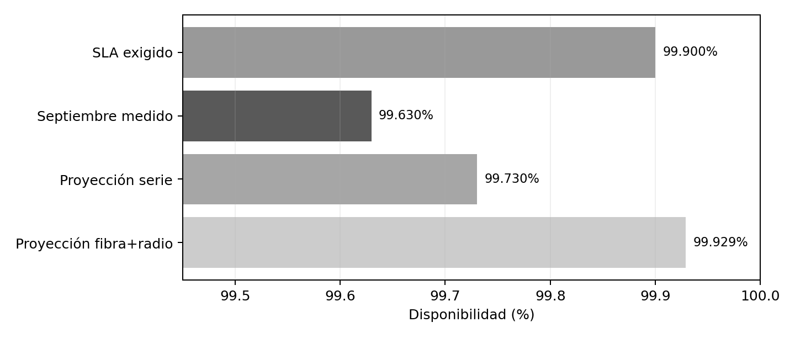
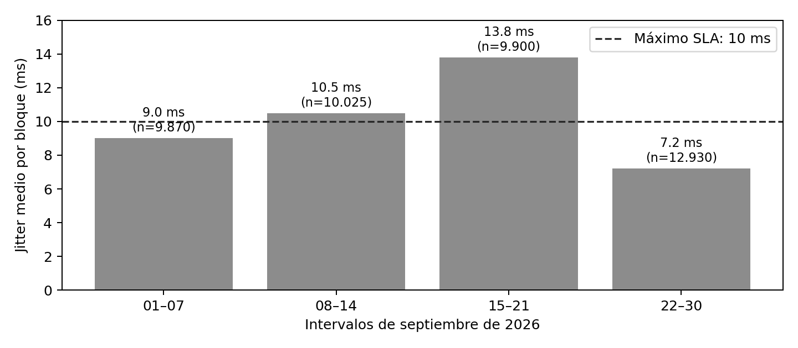

# INFORME TÉCNICO DE VERIFICACIÓN DE SLA

**Evaluación Sumativa 3 · Infraestructura / Redes de Datos · INACAP La Serena**  
**Caso:** Agrícola Valle de Elqui SpA, planta Vicuña · Internet dedicado 200 Mbps  
**Proveedor:** NorteNet Telecomunicaciones  
**Período auditado:** 1–30 de septiembre de 2026  
**Cuenta del repositorio:** `MTAINDARY` · **Autores/integrantes:** completar con los integrantes reales del equipo  
**Versión de contenido:** 1.1 · **Estado de publicación:** pendiente de verificar repositorio público propio  
**Fuente primaria:** *EVA 3 CASO DE ESTUDIO.pdf*, pp. 1–6.

---

## 01. Identificación

| Campo | Información |
|:---|:---|
| Cliente | Agrícola Valle de Elqui SpA |
| Ubicación | Planta Vicuña, Región de Coquimbo |
| Proveedor | NorteNet Telecomunicaciones |
| Servicio | Internet dedicado simétrico 200 Mbps |
| Punto de demarcación | Puerto LAN del CPE instalado en la planta |
| Período | 1–30 septiembre 2026; 30 días, 720 h, **43.200 min** |
| Aplicaciones afectables | ERP, trazabilidad de exportación y telefonía IP |
| Cargo mensual | $1.200.000 netos |
| Repositorio de entrega | **Pendiente:** publicar en cuenta MTAINDARY y adjuntar enlace real con tag v1.1 |

## 02. Resumen ejecutivo

El servicio **no cumple** el SLA de septiembre de 2026. La disponibilidad contractual fue de **99,62963%**, inferior al 99,9% exigido, y el ticket `INC-2672` tuvo una primera respuesta de **66 min**, superando el límite de 60 min. La latencia, el throughput y los tiempos de restauración cumplen; el jitter calculado cumple con salvedades de procedencia, mientras que la pérdida de paquetes no cuenta con cobertura mensual suficiente. El crédito acreditable es **15% del cargo mensual: $180.000 netos**. El tope de 50% no procede con la evidencia disponible.

## 03. Alcance, contrato y referencias

Se examinan las cláusulas 2.1–2.2, 3.1–3.5, 4.1–4.2, 5.1, 6.1–6.2, 7.2 y 8.1–8.4 del contrato simplificado entregado en la pauta (*EVA 3 CASO DE ESTUDIO.pdf*, p. 2). Las mediciones se evalúan en el punto y con los métodos pactados. No se sustituye una prueba en CPE por un Speedtest Wi-Fi ni se compara un RTT entre PE y core con el RTT del enlace desde la demarcación.

### 03.1 Matriz contractual

| Cláusula | Indicador | Operador y umbral | Período, punto y método | Estadístico |
|:---|:---|:---|:---|:---|
| 3.1 | Disponibilidad | ≥ 99,9% | Mes calendario, NMS y tickets del enlace | Tiempo disponible / 43.200 min |
| 3.2 | Latencia RTT | ≤ 30 ms | ICMP cada 60 s, CPE ↔ servidor de medición en La Serena | Promedio mensual |
| 3.3 | Jitter | ≤ 10 ms | TWAMP desde la demarcación, referencia RFC 3393 | Promedio mensual |
| 3.4 | Pérdida | ≤ 0,5% | TWAMP desde la demarcación | Pérdida mensual |
| 3.5 | Throughput | ≥ 180 Mbps | iperf3 TCP, en CPE, 4 pruebas/mes como mínimo | Promedio de pruebas válidas |
| 4.1 | Respuesta | ≤ 60 min | Ticket: apertura → primera respuesta | Todos los incidentes (100%) |
| 4.2 | MTTR | ≤ 240 min | Restauración por incidente atribuible | Cada incidente |
| 5.1 | Validez | ≥ 90% | Cobertura del mes en el punto de medida correcto | Muestras/período cubierto |
| 6.1 | Exclusiones | Aviso ≥72 h y mantención ≤4 h/mes; fuerza mayor declarada; falla de cliente | Avisos y diagnósticos | Clasificación de eventos |
| 6.2 | Denominador | Tiempo excluido = disponible | Mes calendario completo | No restar eventos excluidos del mes |
| 8.1–8.4 | Créditos | Disponibilidad: 10%, 25% o 50%; otras métricas 5% cada una; máximo 50% | Cargo $1.200.000 netos | Según incumplimiento probado |

Las recomendaciones metodológicas RFC 3393 (variación del retardo), RFC 5357 (TWAMP) y RFC 6349 (pruebas TCP) explican cómo medir; **los valores objetivo proceden del contrato**, no de esos RFC. Se usan también los dos apuntes docentes de SLA entregados con el ejercicio.

## 04. Metodología de evaluación y suficiencia de evidencia

Se transcriben las tablas del caso a archivos CSV separados de eventos, tickets y mediciones. El programa `herramientas/calc_sla.py` calcula duraciones desde las fechas, aplica las exclusiones, pondera el jitter, compara valores sin redondeo intermedio y cuantifica el crédito. Para reproducir los resultados utiliza `herramientas/objetivos.yaml`. Las trazas de ejecución se guardan en `evidencias/`.

| Indicador | Fuente admisible | Cobertura / pruebas | Validez y limitaciones |
|:---|:---|:---|:---|
| Disponibilidad | NMS cliente + tickets proveedor (anexos 1 y 2) | Cinco eventos identificados durante septiembre | Completo según evidencia resumida; faltan logs crudos para verificar continuidad del NMS |
| Latencia | ICMP CPE ↔ servidor La Serena (anexo 3) | 42.725 / 43.200 = **98,90046%** | Válida: >90%; no usar 22,1 ms PE–core |
| Jitter | TWAMP demarcación (anexo 4) | 42.725 muestras; **98,90% condicional** a 1 muestra/min | Media calculable. Cadencia e independencia de colector por verificar; hay datos posteriores al 19-sep |
| Pérdida | TWAMP demarcación (anexo 5) | 1–18 sep = **60% de días** | **Evidencia insuficiente** (<90%); no se conoce el dato mensual |
| Throughput | Cuatro iperf3 TCP CPE (anexo 6) | 4 pruebas válidas | Válida según cláusula específica 3.5; descartar Speedtest Wi-Fi |
| Respuesta | Cuatro tickets INC (anexo 2) | 4/4 registrados | Se revisa el 100% individualmente |
| MTTR | NMS + restauración de incidentes atribuibles | 3/3 atribuibles | El contrato no define origen del cómputo; se usa inicio NMS como criterio conservador |

**Observación crítica sobre el jitter:** el anexo 4 registra muestras hasta el día 30, pero el anexo 5 dice que un colector TWAMP se detuvo el día 19. Es posible que sean sesiones o colectores distintos, pero la pauta no permite confirmarlo. Se informa el resultado de jitter como **cumplimiento condicionado a validar su procedencia y cobertura temporal**. Si dependían del mismo colector detenido y no existen mediciones alternativas, su veredicto debe pasar a evidencia insuficiente. Esta incertidumbre no modifica los incumplimientos de disponibilidad y respuesta.

La medición de pérdida de **0,31%** solo representa un subconjunto de septiembre. El proveedor indica **0,18%**, pero lo midió entre PE y core, fuera del trayecto estipulado. Ninguno acredita el porcentaje mensual del servicio contratado.

## 05. Resultados y cálculos

### 05.1 Clasificación de eventos de caída

| Evento | Fecha y horario | Duración | Min atribuibles | Clasificación y fundamento |
|:---|:---|---:|---:|:---|
| E1 | 03-sep 02:00–05:30 | 210 | 0 | Excluido: aviso enviado 29-ago 10:00, **112 horas** antes; mantención 3 h 30 min, menor a 4 h (6.1a, 6.2) |
| E2 | 09-sep 14:12–15:07 | 55 | 55 | Atribuible: corte de fibra por obras viales; sin declaración de fuerza mayor acreditada (6.1b) |
| E3 | 15-sep 10:40–12:25 | 105 | 0 | Excluido: corte eléctrico en instalación cliente, CPE sin UPS (7.2, 6.1c) |
| E4 | 21-sep 22:05–23:20 | 75 | 75 | Atribuible: falla de tarjeta de línea en PE del proveedor |
| E5 | 27-sep 08:30–09:00 | 30 | 30 | Atribuible: mantención emergente avisada 26-sep 18:00, solo **14 h 30 min** antes (<72 h) |
| **Total** | | **475** | **160** | 315 min excluidos, pero cuentan como disponibles para la fórmula contractual |

Aunque E1 consume 210 min de las 4 horas mensuales de mantenimiento excluible, E5 no puede usar los 30 min restantes porque **no cumple el plazo de aviso** de 72 horas. No se ha documentado fuerza mayor formal para E2.

### 05.2 Disponibilidad y caída permitida

Tiempo total: **30 × 24 × 60 = 43.200 min**. Caída atribuible: **55 + 75 + 30 = 160 min**.

**Cálculo:** A = [(43.200 − 160) / 43.200] × 100 = **99,62962963 % ≈ 99,63 %**.

Caída máxima para 99,9%: **43.200 × 0,001 = 43,2 min**. Exceso: **160 − 43,2 = 116,8 min**. Desviación de disponibilidad: **99,62962963 − 99,9 = −0,27037037 puntos porcentuales**.

**Veredicto: NO CUMPLE.** Al estar entre 99,5% y menos de 99,9%, corresponde el **10%** contractual por disponibilidad. Si no hubiera exclusiones, la disponibilidad física observada sería `(43.200 − 475) / 43.200 × 100 = 98,90046%`; **ese resultado no se utiliza para determinar el crédito**, debido a la cláusula 6.2.



### 05.3 Latencia RTT

Cobertura: **42.725 / 43.200 × 100 = 98,90046%**, superior a 90%. Promedio contractual: **27,4 ms**, frente al máximo de **30 ms**. Desviación: **−2,6 ms**. **CUMPLE**.

El percentil 95 (41,2 ms) y el máximo de 118 ms no son parámetros contractuales en este caso. El reporte de proveedor de 22,1 ms tampoco sustituye la medición, porque su prueba se realizó desde el PE hacia el core en Santiago.

### 05.4 Jitter: promedio ponderado por muestras

| Bloque | Muestras | Media del bloque | Contribución (muestras × ms) |
|:---|---:|---:|---:|
| 01–07 sep | 9.870 | 9,0 ms | 88.830,0 |
| 08–14 sep | 10.025 | 10,5 ms | 105.262,5 |
| 15–21 sep | 9.900 | 13,8 ms | 136.620,0 |
| 22–30 sep | 12.930 | 7,2 ms | 93.096,0 |
| **Total** | **42.725** | | **423.808,5** |

**Cálculo:** J = [(9.870 × 9,0) + (10.025 × 10,5) + (9.900 × 13,8) + (12.930 × 7,2)] / 42.725 = 423.808,5 / 42.725 = **9,91944997 ms**.

**CUMPLE CON SALVEDAD:** 9,91945 ms ≤ 10 ms; margen de **0,08055 ms**. No debe calcularse el promedio simple de las cuatro semanas (10,125 ms), porque el último período tiene nueve días y 12.930 muestras. Es necesario verificar la fuente de las muestras posteriores a la falla del colector de pérdida.



### 05.5 Pérdida de paquetes

Cobertura temporal nominal: **18/30 × 100 = 60%**, bajo el 90% mínimo. Harían falta datos de al menos **27 días** de septiembre para alcanzar el umbral temporal nominal; no es posible confirmarlo con el material disponible. **EVIDENCIA INSUFICIENTE**. No debe presentarse 0,31% como promedio mensual ni sumar crédito por pérdida sin evidencia.

### 05.6 Throughput TCP

| Fecha | Punto y herramienta válidos | Resultado |
|:---|:---|---:|
| 05-sep | iperf3 TCP, 4 flujos, 60 s, LAN CPE | 186 Mbps |
| 12-sep | iperf3 TCP, 4 flujos, 60 s, LAN CPE | 182 Mbps |
| 19-sep | iperf3 TCP, 4 flujos, 60 s, LAN CPE | 171 Mbps |
| 26-sep | iperf3 TCP, 4 flujos, 60 s, LAN CPE | 184 Mbps |

Umbral: **200 Mbps × 0,90 = 180 Mbps**.

Promedio válido: **(186 + 182 + 171 + 184)/4 = 723/4 = 180,75 Mbps**, equivalente al **90,375%** del contratado. **CUMPLE** por 0,75 Mbps. El Speedtest de 95 Mbps por Wi-Fi desde el notebook del gerente no es admisible como prueba contractual y no se incluye en la media. El anexo no identifica claramente las dos direcciones; conviene repetir las pruebas de subida y bajada por separado.

### 05.7 Tiempo de respuesta y MTTR

| Ticket | Apertura → respuesta | Respuesta | Exigencia ≤60 min | Duración desde inicio NMS |
|:---|:---|---:|:---|---:|
| INC-2611, E2 | 14:18 → 14:41 | 23 min | Cumple | 55 min |
| INC-2648, E3 | 10:47 → 11:20 | 33 min | Cumple | 105 min, **excluido del MTTR atribuible** |
| INC-2672, E4 | 22:09 → 23:15 | **66 min** | **No cumple (+6 min)** | 75 min |
| INC-2690, E5 | 08:33 → 08:40 | 7 min | Cumple | 30 min |

La cláusula 4.1 exige que el **100%** de los incidentes reciba respuesta dentro de 60 minutos. Solo **3 de 4 (75%)** cumplen. La falla originada en instalaciones del cliente E3 se incluye en el análisis de primera respuesta, pues la cláusula 4.1 se refiere a todos los incidentes; se excluye solo del MTTR atribuible al proveedor. **Respuesta: NO CUMPLE; crédito 5%.**

Para MTTR se utiliza un criterio uniforme y conservador: inicio de la interrupción detectada por NMS hasta la hora de restauración; E2 = **55 min**, E4 = **75 min**, E5 = **30 min**, todos bajo 240 min. Medidos desde la apertura del ticket resultarían 49, 71 y 27 min. Como el contrato abreviado no fija inequívocamente el hito inicial del MTTR, se reportan ambas bases y se adopta la mayor. **MTTR: CUMPLE.**

### 05.8 Tabla final de veredictos

| Métrica | Objetivo | Medido | Desviación | Veredicto / evidencia |
|:---|:---|:---|:---|:---|
| Disponibilidad | ≥99,9% | 99,62963% | −0,27037 pp | **NO CUMPLE**; NMS + tickets |
| Latencia | ≤30 ms | 27,4 ms | −2,6 ms | CUMPLE; 98,90046% cobertura |
| Jitter | ≤10 ms | 9,91945 ms | −0,08055 ms | CUMPLE CON SALVEDAD; TWAMP agrupado |
| Pérdida | ≤0,5% | Mes indeterminado | — | **EVIDENCIA INSUFICIENTE**, 60% de días |
| Throughput | ≥180 Mbps | 180,75 Mbps | +0,75 Mbps | CUMPLE; cuatro iperf3 CPE |
| Respuesta | ≤60 min en 100% | 66 min (máximo) | +6 min | **NO CUMPLE**; INC-2672 |
| MTTR | ≤240 min | 75 min (máximo) | −165 min | CUMPLE; incidentes E2, E4 y E5 |

## 06. Análisis de incumplimientos

El incumplimiento de disponibilidad resulta de tres eventos: corte de fibra por obras viales el **09-sep** (55 min), falla de una tarjeta en el PE el **21-sep** (75 min) y una mantención de emergencia el **27-sep** (30 min) cuyo aviso no cumple las 72 horas mínimas. En conjunto, totalizan **160 minutos atribuibles**. Las operaciones de ERP, trazabilidad y telefonía IP dependen del enlace, pero el enunciado no proporciona registros de transacciones, llamadas ni pérdidas financieras; por ello, solo se acredita la interrupción del acceso y su impacto potencial sobre esos servicios.

El ticket **INC-2672** demoró 66 minutos en obtener primera respuesta frente a los 60 permitidos, aunque el enlace se restauró dentro de las cuatro horas. Se debe investigar el retraso de atención como incumplimiento **diferente** del tiempo de restauración. Por otro lado, el evento E3 (105 min) se excluye contractualmente por ausencia de UPS, pero evidencia un riesgo de continuidad que debe corregir la empresa cliente.

El colector TWAMP que dejó de registrar pérdida desde el 19-sep representa un problema de observabilidad. Aunque el porcentaje parcial está bajo el límite, no permite declarar cumplimiento mensual. Es necesaria una fuente de medida adicional, alarmas de disco lleno y retención de registros. Los picos de latencia y las pruebas individuales bajas motivan investigación, pero no cambian el resultado contractual, que se basa en promedios mensuales.

## 07. Conclusiones técnicas y crédito de servicio

| Concepto | Regla | Porcentaje | Monto neto |
|:---|:---|---:|---:|
| Disponibilidad 99,62963% | 8.1: tramo 99,5%–<99,9% | 10% | $120.000 |
| Respuesta tardía INC-2672 | 8.2: incumplimiento de respuesta | 5% | $60.000 |
| Otras métricas | Sin otro incumplimiento probado | 0% | $0 |
| **Crédito exigible por evidencia** | **8.3: bajo tope de 50%** | **15%** | **$180.000** |

Crédito final: **mín(10% + 5%, 50%) × $1.200.000 = $180.000 netos**. No se cobra 5% adicional por cada corte ni se otorga automáticamente el tope del 50%. La pérdida no tiene un dictamen mensual válido y no genera un crédito demostrado. El resultado global es **NO CUMPLE**.

**Respuesta técnica al gerente.** Es correcto afirmar que hubo varias caídas: fueron cinco eventos físicos, de los cuales tres se atribuyen al proveedor para el SLA. No es correcto usar el Speedtest de **95 Mbps** como demostración contractual, porque se realizó por Wi-Fi y fuera del CPE; las cuatro pruebas válidas promedian **180,75 Mbps**, suficiente para el mínimo pactado. Tampoco el máximo RTT de **118 ms** incumple por sí solo un SLA que evalúa el promedio mensual, que fue **27,4 ms**. Con la evidencia disponible, procede reclamar **$180.000 netos (15%)**, no $600.000 (50%).

## 08. Recomendaciones y anexos

### 08.1 Mejoras priorizadas

| Prioridad | Hallazgo | Medida propuesta | Responsable sugerido |
|:---|:---|:---|:---|
| Alta | Disponibilidad 99,63% vs 99,9% | Diseñar respaldo con diversidad física y verificar conmutación | Proveedor + TI cliente |
| Alta | Respuesta INC-2672 de 66 min | Escalamiento y alertas anticipadas al umbral 60 min | Proveedor |
| Alta | Colector pérdida interrumpido | Recuperar monitorización, alarmas de disco, retención y colector redundante | TI cliente |
| Alta | E3: CPE sin UPS | Incorporar UPS dimensionada y prueba de autonomía | Cliente (7.2) |
| Media | Mantención E5 sin aviso suficiente | Protocolo de cambios con aviso ≥72 h y control de 4 h/mes | Proveedor |
| Media | RTT máximo alto y throughput cercano al mínimo | Diagnóstico de congestión y medición bilateral iperf3 | Proveedor + TI |
| Media | Jitter y MTTR con salvedades | Confirmar colectores, tiempos y definición contractual de MTTR | Ambas partes |

### 08.2 Viabilidad del 99,9% con componentes en serie

Disponibilidades anuales publicadas en el caso: CPE **99,95%**, fibra de acceso de ruta única **99,80%**, PE La Serena **99,99%**, backbone **99,99%** y radio de respaldo ofertado **99,50%**. Se utilizan **como estimación de diseño bajo fallas independientes**, no como garantía de disponibilidad mensual real.

**En serie:** A = 0,9995 × 0,9980 × 0,9999 × 0,9999 = 0,99730150977501 = **99,73015 %**.

Esto **no alcanza el 99,9%**. La caída mensual equivalente sería `(1 − 0,99730150977501) × 43.200 = 116,57 min`, por encima de los 43,2 minutos máximos. Incluso la fibra de acceso por sí sola, con 99,80%, queda por debajo del objetivo.

### 08.3 Fibra y radio en paralelo, con CPE/PE/backbone comunes

Solo se pone en paralelo el **acceso** (fibra y radio), porque la pauta ofrece un radioenlace de acceso, no una segunda red completamente independiente. Se mantienen CPE, PE y backbone en serie.

**Acceso en paralelo:** A_acceso = 1 − [(1 − 0,9980) × (1 − 0,9950)] = 0,99999 = **99,999 %**.

**Total con acceso de respaldo:** A = 0,9995 × 0,99999 × 0,9999 × 0,9999 = 0,9992901169939 = **99,92901 %**.

La caída mensual equivalente sería **30,67 min**, aproximadamente **12,53 min** menos que el máximo de 43,2 min. El modelo **sí supera nominalmente 99,9%**, pero únicamente bajo el supuesto de independencia de fallas. No garantiza ese SLA si el radio comparte energía, CPE, emplazamientos o enlaces críticos con la fibra. Es necesario verificar topología, continuidad de alimentación, disponibilidad efectiva, capacidad y tiempos de conmutación antes de contratar el respaldo.

### 08.4 Evidencias prácticas y versión

El toolkit se compone de `herramientas/objetivos.yaml`, `herramientas/calc_sla.py`, `datos/*.csv`, pruebas en `tests/` y evidencias calculadas en `evidencias/`. El comando de ejecución es:

```bash
python herramientas/calc_sla.py -o herramientas/objetivos.yaml -d datos --salida-json evidencias/resultados.json --salida-texto evidencias/salida_calc_sla.txt
python -m unittest discover -s tests -v
```

La primera ejecución fue correcta y las **11 pruebas automatizadas finalizaron OK**. La salida en texto y el JSON respaldan los valores presentados. También se incluye una guía para tomar evidencias de terminal local, registrar el commit y publicar en GitHub con la etiqueta **v1.1**. **No se afirma que el repositorio remoto exista hasta comprobar su publicación.**

### 08.5 Datos pendientes para auditoría completa

Para pérdida, requieren al menos 90% de cobertura mensual efectiva y contadores TWAMP de paquetes perdidos, enviados, timestamps y punto de demarcación. Para jitter, confirmar que la medición del 19–30 sep provenga de un colector operativo y conocer la cadencia real. Para throughput, revisar dirección de transmisión y salidas detalladas de iperf3. Para MTTR, convenir expresamente el momento inicial de restauración. Para el respaldo, solicitar diagrama real y cotización antes de evaluar disponibilidad y costo.

### 08.6 Referencias

1. **EVA 3 CASO DE ESTUDIO.pdf**, pauta de evaluación, pp. 1–6, INACAP, caso Agrícola Valle de Elqui SpA, septiembre de 2026 (fuente de todos los datos contractuales y mediciones).
2. **SLA y niveles de servicio en redes.pdf**, material docente de apoyo (conceptos, métricas, cálculos y viabilidad).
3. **SLA y niveles de servicio · Conceptos clave.pdf**, material docente complementario.
4. **Caso_Clinica_Limari.pdf**, ejemplo docente de estructura de informe técnico y formato de toolkit, no fuente de datos numéricos de Valle de Elqui.
5. RFC 3393, *IP Packet Delay Variation Metric for IP Performance Metrics (IPPM)*, https://www.rfc-editor.org/rfc/rfc3393.
6. RFC 5357, *A Two-Way Active Measurement Protocol (TWAMP)*, https://www.rfc-editor.org/rfc/rfc5357.
7. RFC 6349, *Framework for TCP Throughput Testing*, https://www.rfc-editor.org/rfc/rfc6349.

**Nota de veracidad:** todos los cálculos derivan de los valores del caso docente. No se han creado ni presentado registros originales de Zabbix, TWAMP, IPERF, tickets ni de red del proveedor.
